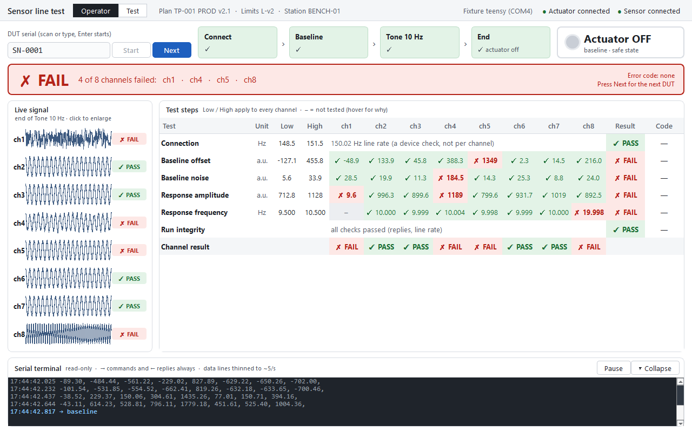

# sensortest: sensor line test station

Line test software for a simulated piezo sensor (8 output channels) and its actuator, running on a preflashed Teensy (Eight Sleep take-home). It drives the actuator, captures all 8 channels, judges each one against data-derived limits, and gives the operator one clear PASS / FAIL / ERROR, with a self-contained record for every run.



**Status:** the station runs end to end on the Teensy and on synthetic recordings, with its GUI (operator and test modes). CI tests it and builds the app on Windows, Linux and macOS on every push. Next: the report.

## Run the prebuilt app

Every push lints, tests, builds and smoke-tests the app on all three operating systems ([CI workflow](.github/workflows/ci.yml)); all three pass. The smoke test runs the built app headless; on Linux and macOS the GUI itself hasn't been opened by a person yet. Download it from the [Actions page](https://github.com/akkhilmorkonda/sensortest/actions): open the latest run on `main`, then the **Artifacts** section. You need to be signed in to GitHub.

| OS | Artifact | Start it |
|---|---|---|
| Windows | `sensortest-Windows` → `sensortest.exe` | Double-click it. It's unsigned, so Windows SmartScreen may ask first: **More info → Run anyway** |
| Linux | `sensortest-Linux` → `sensortest` | `chmod +x sensortest && ./sensortest`. Qt needs `libxcb-cursor0` (on Ubuntu: `sudo apt install libxcb-cursor0`) |
| macOS | `sensortest-macOS` → `sensortest-macos.zip` | Unzip it, then right-click `sensortest.app` → **Open** (it's unsigned). From a terminal: `sensortest.app/Contents/MacOS/sensortest` |

- **It starts on the Teensy.** The Teensy is found by its USB ID (`16C0:0483`) on any OS. To try the app without hardware, start it from a terminal with `--fixture synthetic`.
- **Settings and records:** on first run the app copies its settings to `~/sensortest/config/` (Windows: `C:\Users\<you>\sensortest\config\`), where you can edit them. Every run's record goes to `~/sensortest/output/`. Set `SENSORTEST_HOME` to use another folder.
- **Headless runs** work from the app too, for example `sensortest.exe --headless --fixture synthetic --fast --serial SN0001`.

## Install and run from source

You need **Python 3.12 or later** and git.

**Windows** (PowerShell):

```powershell
git clone https://github.com/akkhilmorkonda/sensortest.git
cd sensortest
python -m venv .venv
.venv\Scripts\python -m pip install -e ".[dev]"
.venv\Scripts\python -m sensortest
```

**Linux** (Ubuntu or Debian):

```bash
sudo apt install python3-venv libxcb-cursor0     # Qt 6 needs libxcb-cursor0
sudo usermod -aG dialout $USER                   # serial-port access for the Teensy; log out and back in
git clone https://github.com/akkhilmorkonda/sensortest.git
cd sensortest
python3 -m venv .venv
.venv/bin/python -m pip install -e ".[dev]"
.venv/bin/python -m sensortest
```

**macOS:**

```bash
git clone https://github.com/akkhilmorkonda/sensortest.git
cd sensortest
python3 -m venv .venv
.venv/bin/python -m pip install -e ".[dev]"
.venv/bin/python -m sensortest
```

The commands are the same on every OS after that; only the path to the venv's Python differs (`.venv\Scripts\python` on Windows, `.venv/bin/python` on Linux and macOS):

```bash
python -m sensortest                                  # the GUI on synthetic recordings (no hardware, no data)
python -m sensortest --fixture teensy                 # the GUI on the Teensy
python -m sensortest --headless --serial SN0001 --runs 3 --fast   # headless PROD runs
python -m pytest                                      # the tests (no hardware or bench data needed)
```

From source, the default fixture is `synthetic`: it plays recordings generated from the device model measured in Part 1, so the station runs on any machine (D-060). `--fixture replay` plays the real DOE-1 recordings instead; those are bench data, kept on the bench machine (see Data). `--fast` replays without real-time pacing, and `--sequence ENG` runs the full engineering plan headless. In the GUI, enter a DUT serial and press Enter. **Test** mode (top left) adds the PROD/ENG picker and the engineering panels.

## Build the one-file app

```bash
python tools/build_app.py      # with the venv's Python, from the repository root
```

| OS | Result |
|---|---|
| Windows | `dist/sensortest.exe` (one file, about 52 MB) |
| Linux | `dist/sensortest` (one file) |
| macOS | `dist/sensortest.app` (an app bundle; PyInstaller builds macOS apps as a bundle) |

- **Each OS builds its own app**, because PyInstaller can't cross-compile. CI runs this same script on all three.
- **What goes in:** the `sensortest` package and its dependencies, and the config the station loads (settings, the sensor test file, the active limit set). Nothing from `tests/`, `tools/`, `benchtop_testing/` or `docs/` goes in. The packaged settings default to the Teensy fixture.
- **The smoke test:** after building, the script runs the new app headless on synthetic recordings. It must exit cleanly and write a record (`--smoke-only` reruns just that).

## Tests

```bash
python -m pytest              # 97 tests: no hardware and no bench data needed (with the venv's Python)
python -m pytest --hardware   # also the 2 tests that run PROD and ENG on the Teensy (plug it in first)
```

CI runs the suite on Windows, Linux and macOS on every push. The GUI tests run offscreen, so no display is needed. The tests that need recorded data run on **synthetic recordings** made from the device model measured in Part 1 (`devices/replay/synthetic.py`): they give the same verdicts as the Teensy (ch1 weak, ch4 noisy, ch5 offset, ch8 wrong frequency), so the whole station is tested end to end without the device.

| File | Tests | What they check |
|---|---|---|
| `test_methods.py` | 9 | The measurement maths (sine fit, dominant frequency, amplitude at the response frequency, stuck runs, outliers, line rate) on signals with known answers |
| `test_devices.py` | 25 | The serial link (134 baud refused, open retries, a device that sends nothing); the Teensy drivers on an in-memory fake Teensy (every reply fault, stalls, a lost device, Abort); the device manager and fixture validation |
| `test_engine_replay.py` | 17 | Full PROD and ENG runs give the expected verdicts and a complete CSV record. Each of 6 injected faults ends in the right error code with the actuator turned off. Also Abort, Retry once, Next, DUT serial validation, and bad input files going to Not ready |
| `test_state_machine.py` | 7 | The state machine's transition table, e.g. every way out of Running goes through the safe state |
| `test_gui_smoke.py` | 5 | The real window driven through its own buttons: the operator flow (FAIL banner, table cells, channel chips, terminal), ERROR with Retry once, test mode with the ENG preview, the enlarged plot, and the live-data buffer |
| `test_live_plumbing.py` | 7 | The live samples add up exactly to the windows that were judged; commands, replies and the actuator's reply reach the screen |
| `test_core_contracts.py`, `test_limit_sets.py` | 7, 3 | Error codes, registries, inclusive limits, the plan compiler's checks; the limit sets and the one the station runs |
| `test_synthetic.py` | 3 | The synthetic recordings have the bench format, are reproducible, and give the Teensy's verdicts through the limit-derivation code |
| `test_packaging.py` | 3 | Where the app finds its settings, from source and as a packaged app |
| `test_architecture.py` | 11 | Each package imports only what the architecture allows, and Qt stays in `ui/` and `app/` |
| `test_teensy_hardware.py` | 2 | PROD and ENG on the real Teensy (`--hardware` only) |

## Repository map

```
config/              what the station loads: settings.yaml, sensor_tests.yaml, TP-001_limits_v2.yaml
  archive/           earlier limit sets, kept as records (the station can't load them)
src/sensortest/      the station (one package per layer, see Architecture)
tests/               the pytest suite, including offscreen GUI tests and an in-memory fake Teensy
tools/               developer scripts: build the app, screenshots of the real app
docs/                PRD, test plan TP-001, GUI spec, device protocol; gui_screens/; archive/
benchtop_testing/    Part 1 bench work: captures, analyses, limit derivations and their tools (evidence)
DESIGN.md            how I used AI tools on this project (the brief's AI usage note)
.github/workflows/   CI: lint, test, build and smoke-test the app on Windows, Linux and macOS
```

## Architecture

Ports and adapters (`docs/software_prd.md` §6). The dependency rule is enforced by `tests/test_architecture.py`, and only `ui/` and `app/` may import Qt.

| Package | What it does |
|---|---|
| `core/` | Pure domain: models, error codes, ports (interfaces), measurement methods. Imports nothing internal |
| `events/` | Commands and events, and the in-process event bus |
| `plans/` | The plan compiler: sensor test file + settings + limit set → a runnable `CompiledPlan` |
| `steps/` | The metrics (`@metric`), one function per measured quantity |
| `engine/` | The test executive: the state machine (`states.py`, a transition table), the capture loop, evaluation |
| `devices/` | The device manager and one folder per device: `teensy/` (the real one) and `replay/` (the recorded Teensy, for work without hardware) |
| `sinks/` | Result outputs (`@sink`): one CSV per run plus its raw data |
| `characterization/` | The limit derivation from bench recordings, with the same math the station runs |
| `ui/` | The PyQt6 station screen; buttons (`@action`) and test-mode panels (`@panel`) |
| `app/` | The composition root: settings, wiring, the GUI and headless entry points |

**Threads:** the engine runs on its own thread; each serial link has a reader thread; Qt stays on the UI thread, fed by `ui/bridge.py`. Live data reaches the screen through buffers drained by one timer (`ui.plot_fps`).

## Common tasks

| Task | How |
|---|---|
| Run the tests | `python -m pytest`: no hardware and no bench data needed (the replay runs on synthetic recordings); add `--hardware` to also run PROD + ENG on the Teensy |
| Lint and format | `ruff check .` and `ruff format .` (in the venv) |
| Add a test step | A function with `@metric("key")` in `steps/builtin.py`; the metric and a step (ID, capture, family, operator `title`) in `config/sensor_tests.yaml`; its limit in the limit set; its ID in a plan list in `config/settings.yaml` |
| Add a device | A folder `devices/<name>/` with an `@actuator` and/or `@sensor` driver (and an `@link` only for a new kind of connection); one import in `app/wiring.py`; a fixture in `config/settings.yaml` naming each role's driver and link |
| Change the limits | `benchtop_testing/tools/derive_limits.py` writes a new limit set into `config/`; point `limits:` in `config/settings.yaml` at it. Never edit a generated limit set by hand |
| Inject a fault | Set `fault:` on a replay link in `config/settings.yaml` (`wrong_ack`, `no_reply`, `stall`, `drop_lines`, `lost`, `reject_baseline`) |
| Build the app | `python tools/build_app.py` (see Build the one-file app) |
| Regenerate the screenshots | `python tools/capture_screens.py` (see `tools/README.md`) |

## Configuration and outputs

- **`config/settings.yaml`:**
  - the station name and the DUT serial format;
  - the PROD and ENG plans (lists of step IDs);
  - the fixtures, each naming a driver and a link for the actuator and the sensor; `active_fixture` picks one;
  - the UI refresh rate.
- **Records:** every run (aborted ones too) writes `output/<date>/<SERIAL>_<run_id>.csv` and a `_raw.csv` with the measured windows. The app log goes to `output/logs/`. `output/` is not in git.

## Data

**No bench or manufacturing data is in git (D-059, D-060).** The repository holds code, configuration, documents and the bench scripts; the data stays where it was made:

- **Manufacturing data:** the station's records and logs in `output/`.
- **Bench data:** the raw captures, the gauge run's records, metric tables, reports and figures in `benchtop_testing/<experiment>/`, on the bench machine. `benchtop_testing/README.md` describes each folder. Put a copy back there to re-run an analysis, the limit derivation, or the `replay` fixture on the real DOE-1 recordings.
- **Synthetic recordings:** generated on demand from the device model (`devices/replay/synthetic.py`), in the bench format. The tests and the default fixture use them, so a fresh clone works without any data.

## Documents

| Document | What it covers |
|---|---|
| `docs/software_prd.md` | Requirements, architecture, state machines, timing, how to extend it |
| `docs/test_plan.md` | Test plan TP-001: the procedure, every step and method, verdict rules, error codes, the limits |
| `docs/gui_spec.md` | The station screen: regions, states, visual rules, widgets |
| `docs/device_protocol.md` | The Teensy's serial protocol, as measured |
| `DESIGN.md` | How I used AI tools: where and how, how the work was checked, and where AI-assisted work may need review |
| `benchtop_testing/README.md` | The bench work behind the limits: what was run, what it found |

**Decision IDs** such as D-056 in the code and documents refer to my decision log (each decision's reasoning and the options not chosen). It's kept outside this repository, with my other planning notes.
