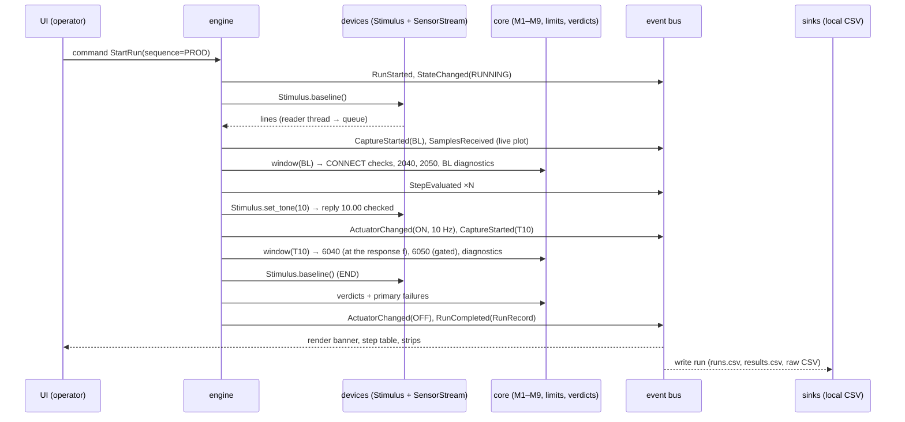

# Sensor Test Software: Product Requirements and Architecture (PRD)

| | |
|---|---|
| **Document** | PRD-001 Sensor test software |
| **Version** | **v0.15 draft**, 2026-11-08 (no data in git, tests on synthetic recordings: D-059, D-060; no phase jumps assumed: D-058; no phase, amplitude at the response frequency, L-v2: D-056; the station screen: D-054) |
| **Feeds** | Roadmap sections 05 (walking skeleton), 03 (drivers + measurement core), 06–12 |
| **Inputs** | The assignment brief; my requirements (2026-11-07); TP-001 test plan (`docs/test_plan.md`); D-001–D-031 (my decision log, kept outside the repository) |

**Source tags:**

| Tag | Meaning |
|---|---|
| **[Brief]** | Required by the assignment |
| **[Mine]** | My stated requirement |
| **[D-xxx]** | Already decided |
| **[Proposed]** | Claude's proposal, not yet decided |
| **[Open]** | Needs a decision (§14) |

---

## 1. Purpose

A desktop application that runs a manufacturing line test on a sensor sub-assembly. Each sensor is stimulated by an actuator, and the software decides whether its response is adequate. **[Brief]**

It executes the test plan TP-001 (PROD for every unit, ENG for audits) against the limits file, shows the operator an unambiguous result, and records everything needed for engineering analysis. **[D-028, D-029]**

## 2. Users and what each needs

| User | Needs | Sees |
|---|---|---|
| **Operator** | Start a test, know what's happening, get an unmistakable PASS/FAIL/ERROR and what to do next **[Brief, D-003]** | **Operator mode** (D-053): fixture status, sequence bar, actuator indicator, result banner, the **test-step table** (each step's name, limits, the 8 channel measurements, result, error code), 8 live strips and a read-only serial terminal. No step IDs or diagnostics |
| **Test / manufacturing engineer** | Run ENG sequences, inspect values vs limits, read diagnostics and raw data, change limits by file, analyze trends **[D-003, D-029]** | **Test mode** (D-053): the same screen plus a PROD/ENG picker, step IDs, diagnostics (read-only), the run header and raw windows |
| **Developer** | Add a test step, device, integration or UI control **without touching the core or rewriting existing code**; understand the codebase quickly; trust the tests **[Mine]** | Clean module boundaries, registries, extension recipes (§9), and tests that run without hardware |

## 3. Design principles **[Mine]** (with the concrete rules that enforce them **[Proposed]**)

1. **Modular, decentralized architecture that scales by addition.** New capability means **adding** a module and registering it, never editing or replacing an existing one.
   - *Rule:* each package has one job and a stable interface. Packages talk through interfaces, commands and events, never by reaching into each other's internals.
2. **The core is separate from test cases, devices and integrations.**
   - *Rule:* the core (models, measurement methods, the verdict engine) imports **nothing** from devices, UI, storage or Qt.
   - Test cases are **data** (plan + limits files) plus small registered functions. Devices and integrations are plugins behind interfaces.
3. **Extensible UI without a rewrite.** Adding a button or panel is a registration plus a layout entry. Existing views aren't edited.
   - *Rule:* the UI never calls drivers or the sequencer directly. It sends **commands** and renders **events**.
4. **Developer experience: clean, organized, as simple as possible.**
   - *Rule:* plain Python (dataclasses, Protocols, the standard library) and **no frameworks** beyond PyQt6, pyqtgraph, pyserial and numpy.
   - Type hints throughout, one formatter/linter, and one command to run each of: tests, the app, a headless run.
5. **Extremely reliable:** explicit error handling, retry policies and timeout management.
   - *Rule:* every external operation has a **timeout, a retry policy and an error code** (§8). No bare `except`. No silent failures.
   - The device always ends in a safe state (`baseline`) **[D-010]**.
6. **Deterministic and testable.** The same raw data gives the same result anywhere **[D-025, D-027]**. Every layer runs without hardware via the replay driver **[D-031]**.

---

## 4. Functional requirements

| ID | Requirement | Source |
|---|---|---|
| FR-01 | Discover the device by USB ID, connect at 115200 baud (**never 134**), detect disconnects, recover cleanly | [Brief] key element 1, D-007, D-008 |
| FR-02 | Send commands with LF only; validate every reply; enforce the frequency range 1–19 | D-007, D-009 |
| FR-03 | Load and validate a test plan + limits + metric dictionary (versioned files); refuse an invalid plan (E301/E302) | [Brief] nice-to-have 2, D-004, D-009 |
| FR-04 | Run the PROD or ENG sequence: captures, measurement methods (M1–M4, M6–M9; M5 removed by D-056, M10 by D-058), limit steps, validity steps, NOT TESTED (frequency with no tone). Every step is judged on its own channel alone, with no step dependencies (D-056) | TP-001 §4–8 |
| FR-05 | Verdicts: PASS/FAIL per sensor, ERROR per run with an error code and operator action; primary failure by diagnostic rank | D-009, D-023, D-026 |
| FR-06 | **Real-time plot** in both modes: **8 strips, one per channel, each on its own scale**; click a strip to enlarge it with axes | [Brief] key element 2, **D-053** (revises D-035) |
| FR-07 | **Clear indicators** for actuator ON/OFF and the current parameters (frequency, step, time remaining): a large actuator indicator in the operator view | [Brief] key element 2, D-035 |
| FR-08 | Numeric results shown against thresholds **in both modes** (the test-step table) and an unmistakable PASS/FAIL/ERROR banner | [Brief] key element 3, **D-053** (revises D-003) |
| FR-09 | The operator always knows the current state, step, progress and next action | [Brief] key element 4 |
| FR-10 | **One self-contained local CSV per run** with all relevant test information, pass/fail and metrics, for every run including aborted and errored runs: `output/<date>/<SERIAL>_<run_id>.csv` (one row per step × sensor, run fields on every row, metadata JSON on the run-level rows) plus `_raw.csv` | [Brief] key element 5, D-029, D-032, **D-048** |
| FR-11 | Abort at any time; the actuator always turns off (baseline) on abort, error, close or crash | D-010 |
| FR-12 | Multiple sensors per run (8) | [Brief] nice-to-have 1 (built in) |
| FR-13 | Run on Windows, Linux and macOS; a one-file binary | [Brief] key element 6, deliverable 4 |
| FR-14 | Diagnostics in `metadata` JSON, read-only in the engineering view | D-029 |
| FR-15 | *(P1)* Export the chart (PNG); batch sequencing (run N, compare) | [Brief] nice-to-haves 5, 6 |
| FR-16 | *(P2)* Cloud upload of results (AWS) via an integration plugin | [Brief] nice-to-have 3 |
| FR-18 | **Device manager:** knows at all times which devices are connected and which **roles** they provide (actuator, sensor). A run may start **only if every role the plan needs is connected**. For this assignment, a plugged-in Teensy provides both roles | **D-037** [Mine] |
| FR-19 | **Connections panel** in the GUI (built as the title bar's fixture status, D-053/D-054): a simple ✓ / ✗ per role (actuator, sensor), always visible | **D-037** [Mine] |
| FR-20 | **Manual start:** the operator presses Start; Start is enabled only in Idle with all roles connected | **D-037** [Mine] |
| FR-24 | **DUT serial per run:** the operator enters (or scans) the DUT serial before every run; Start is disabled until it matches `serial_pattern` (settings); Enter starts the run; the serial is locked during the run and cleared on Next. Headless runs take `--serial` | **D-047** [Mine] |
| FR-25 | **Test-step table** (both modes): one row per step in run order, so it previews the plan before Start; columns Test (operator name + unit), Low, High, ch1–ch8 measurements (✓/✗ and green/red, NOT TESTED with its reason as a tooltip), Result, Code; a Channel result row; fills in live | **D-053**, `docs/gui_spec.md` §4.4 |
| FR-26 | **Read-only serial terminal**: commands and replies always, data lines thinned to ~5/s, Pause; collapsible; never accepts input | **D-053** |
| FR-27 | **Two modes on one screen:** Operator (locked to PROD) and Test (adds a PROD/ENG picker, step IDs, diagnostics, run header, raw windows). The DUT is **one sensor with 8 channels**: one verdict, and each channel's result and primary failure | **D-053**, D-002 (reversed) |
| FR-21 | **Abort** is its own run result, **ABORTED** (next to PASS, FAIL and ERROR): safe-stated, sensors NOT TESTED, record written | **D-038** |
| FR-22 | **Next:** the result stays on screen until the operator presses Next; Start is disabled until then | **D-039** |
| FR-23 | **Test definitions and plan selection:** all test steps are defined in a **sensor test file**. The **settings file** defines two test plans, **PROD** and **ENG**, each an explicit list of the tests it runs. The **operator view is locked to PROD**; the **engineering view has a dropdown** to choose PROD or ENG | **D-040** [Mine] |
| FR-17 | **Headless run** (no GUI) of a sequence, e.g. `python -m sensortest --headless --sequence PROD --runs 20`, for batch runs, the ~20-run gauge check (L-v1), CI on the replay driver, and debugging. Same engine, no UI | **D-034** |

## 5. Non-functional requirements

| ID | Requirement | Target |
|---|---|---|
| NFR-01 Responsiveness | The UI never blocks; device I/O and evaluation run off the UI thread | No UI freeze > 50 ms during a run |
| NFR-02 Overhead | Software overhead per PROD run beyond the captures | < 0.5 s (run ≈ 5.0 s, D-024/D-028) |
| NFR-03 Plot | Live plot refresh decoupled from the 150 Hz data rate | ~20–30 fps, all 8 channels |
| NFR-04 Determinism | Results are a pure function of raw data + plan + limits + code version | D-025, D-027 |
| NFR-05 No data loss | A run record is never lost: if the primary storage fails, a local fallback file is written | §8 |
| NFR-06 Safety | Never open at 134 baud; never write firmware; baseline on every exit path | D-007–D-010 |
| NFR-07 Testability | Core ≥ 90% line coverage; engine and verdicts tested end to end on the replay driver; all error codes tested by fault injection | §11 |
| NFR-08 Portability | Pure-Python dependencies with wheels on all three OS | §12 |
| NFR-09 Observability | A separate rotating **application log** (debug/info/warn/error) apart from test records | §8 |

---

## 6. System architecture **[Proposed]**

### 6.0 Ports-and-adapters (hexagonal) view (2026-11-07, confirmed by me)
Drawn in the format of my reference diagram: a protected core, with everything replaceable on its edge.
- Both **GUI and CLI pull the same levers** (commands through the event bus). The core can't tell which interface asked.
- **Data lives outside the core; logic lives inside.**

**What lives where, and how hard it is to change:**

| Tier | What | Examples | How to change |
|---|---|---|---|
| **Data (edit, no code)** | Inputs the core reads | Sensor test file (step definitions), settings YAML (PROD/ENG lists, device profile, policies), limit sets (L-v0, L-v1 as records; L-v2 active, D-056), metric dictionary | Edit the file; validated on load (E301/E302); versioned |
| **Adapters and plugins (add a file + register)** | Everything on the edge | GUI views/actions/panels (`@action`, `@panel`), CLI, links and drivers (`@link`: serial, replay; `@actuator` and `@sensor`: Teensy, replay, D-049), sinks (`@sink`: CSV now; AWS, MES/STDF later), metric functions (`@metric`) | Add a module and register it; no core edits |
| **Core (review + tests)** | The platform's logic | Event bus, engine (state machine), plan compiler, measurement (M1–M4, M6–M9, limits, verdicts), device manager, result builder, the ports | Changes need review and the test suite |

**Mapping to my reference diagram:**

| Reference diagram | This design |
|---|---|
| Event bus | Event bus |
| Test plan compiler | Plan compiler (the `plans/` package) |
| Scheduler-executor | Engine |
| Resource manager | Device manager |
| Result and artifact manager | Result builder |
| Data models | Core models |
| Persistence | A **sink adapter** (CSV), deliberately outside the core |
| Developer / debug tools | CLI adapter |

### 6.1 Layers and dependency rule
```
                ┌──────────── app (composition root: config, wiring, CLI + GUI entry) ────────────┐
                │                                                                                  │
   ui (PyQt6) ──┤  commands ▶                                       ◀ events                       ├── sinks (integrations)
   views, widgets, actions                                                                         │   local CSV log files (D-032),
                │                         engine (test executive)                                  │   future: AWS, STDF, MES
                │          state machine · captures · steps · retries · timeouts                   │
                │                 │                    │                    │                      │
                │          devices (HAL)          steps / metrics      plans (loader)              │
                │          Stimulus + SensorStream   registry          schema validation           │
                │          links + actuator/sensor                                                 │
                │          drivers: teensy, replay                                                 │
                └──────────────────────────────── core (pure) ─────────────────────────────────────┘
                     models · methods M1–M9 · limit evaluation · verdict engine · error codes
```
**Dependency rule (enforced in code review and checked by a test):**
- `core` imports nothing internal.
- `devices`, `steps` and `plans` import only `core`.
- `engine` imports `core`, `steps`, `plans` and the **device interfaces** (never a concrete driver).
- `ui` and `sinks` import `core` models and the **event/command types** only.
- `app` is the only place that knows the concrete classes and wires them together.

### 6.2 Packages
| Package | Responsibility | Key interfaces / contents | Must NOT |
|---|---|---|---|
| `core/` | Domain model and pure math | Frozen dataclasses: `Capture`, `Window`, `StepResult`, `RunRecord`, `Verdict`, `ErrorCode`. Methods M1–M4, M6–M9 (M5 removed by D-056, M10 by D-058). Limit evaluation. Verdict and primary-failure logic | Do I/O, use Qt, know about devices |
| `devices/` | Hardware abstraction (HAL) and the **device manager** | `Stimulus` protocol (`baseline()`, `set_tone(f)` → the accepted reply), the **actuator role**; `SensorStream` protocol (`acquire(settle, window, cancel, on_chunk)`; `on_chunk` gets every line in 15-line chunks for the live plot), the **sensor role**; each driver's `on_traffic` hook reports commands, replies and thinned data lines for the terminal (D-054); `DeviceInfo`. **Links** (`@link`): one per physical connection, opened once per run, shared by the drivers on it: `serial` (one USB serial port), `replay` (DOE-1 recordings played as a recorded Teensy, with fault injection). **Role drivers** (D-049): `@actuator` and `@sensor`, each `teensy` and `replay`, each attached to a link named in the settings. **`DeviceManager`** (D-037): polls each link's discovery, reports ✓/✗ per role, publishes `DeviceStatusChanged`, and builds the run's session from the two drivers. Three registries. **Layout (D-059):** one folder per device, `devices/teensy/` and `devices/replay/` (the recorded Teensy), with the generic pieces (manager, registry, serial link) at the top | Decide pass/fail, know about plans |
| `plans/` | Load and validate the plan, limits and metric dictionary | Schema validation with exact error messages, version pinning. A `Plan` object (sequences → captures → steps) | Run anything |
| `steps/` | The test-case library | Step types (`LimitStep`, `ValidityStep`, `Diagnostic`); a **metric registry** mapping metric key → method function | Talk to devices or the UI |
| `engine/` | The test executive | State machine (§7.3), capture runner, timeouts and retries (§8), run-level safe-state; publishes events, accepts commands | Import Qt or a concrete driver |
| `events/` | Typed messages | Events (§7.2) and commands; a tiny in-process publish/subscribe bus | Contain logic |
| `characterization/` | Part 1 in product code (D-050) | Re-cut DOE-1 recordings with the plan's capture timing; the metric table from the `@metric` functions; the D-019 limit rule; each run through the engine's evaluation. Used by the golden tests and `benchtop_testing/tools/derive_limits.py` | Run on the station, import Qt or the UI |
| `sinks/` | Integrations for results | `ResultSink` protocol (`on_event`, `write_run`). Built-in: **local CSV** (runs, results, raw; D-032). Later: AWS, STDF, MES. A registry | Change results |
| `ui/` | PyQt6 presentation | **One screen, two modes** (D-053, built D-054; `docs/gui_spec.md`): title bar (mode switch, plan, fixture status ✓/✗ per role), control row (DUT serial, buttons, sequence bar, actuator lamp), result banner, 8 live strips + the test-step table (or one channel enlarged), read-only serial terminal; test mode adds the PROD/ENG picker, step IDs and the run header and diagnostics tabs. An **action registry** for buttons (control row, result banner); a **panel registry** for test-mode tabs; a Qt bridge that turns bus events into Qt signals on the UI thread; one timer drains the live buffers at `ui.plot_fps` | Call drivers or the engine directly; compute metrics |
| `app/` | Composition root | Station config, logging setup, wiring of registries; `python -m sensortest` (GUI) and `--headless` (CLI) | Contain business logic |

---

## 7. Data flow

### 7.1 One PROD run, end to end


### 7.2 Messages
- **Commands** (UI or CLI → engine): `Connect`, `Disconnect`, `LoadPlan`, `StartRun(sequence)`, `Abort`, `RetryRun`, `ExportChart`.
- **Events** (engine → everyone):
  - `DeviceConnected` / `DeviceLost`, `PlanLoaded`;
  - `StateChanged`, `RunStarted`, `CaptureStarted`, `ActuatorChanged(on, f)`;
  - `SamplesReceived(batch)`, `StepEvaluated`, `DiagnosticsComputed`;
  - *As built (D-054):* `DeviceStatusChanged`, `PlansLoaded(… plans)`, `AppStateChanged`, `ActuatorChanged(on, f, command, reply)`, `SamplesArrived(capture, start, t, x)`, `TrafficSeen(direction, text, t)`; diagnostics travel in the `RunRecord`, and errors end in `RunCompleted` with the code;
  - `RunCompleted(RunRecord)`, `RunErrored(code, detail)`, `Warning(code)`.
- **Rules:**
  - Events are immutable and carry plain data.
  - Subscribers can't block the engine: slow subscribers get their own queue.
  - Adding a subscriber never requires editing the publisher.

### 7.3 State machines (D-037 to D-040)
Three levels; diagrams drawn 2026-11-07.

**(a) Operator / app level**

| From | Event | Guard | To | Action |
|---|---|---|---|---|
| Starting | Settings, sensor test file, limits valid | — | **Idle** | Start the device manager |
| Starting | Invalid file (E301/E302) | — | **Not ready** | Show the error |
| Not ready | Reload | — | Starting | — |
| Idle | `DeviceStatusChanged` | — | Idle | Update the connections panel (✓/✗ per role); enable Start only if every role the plan needs is connected |
| Idle | Plan selected (engineering view only) | — | Idle | PROD or ENG; the operator view is always PROD |
| Idle | **Start** (manual) | **All required roles connected** | **Running** | New run_id |
| Running | All captures + end baseline OK | — | **Result** (PASS / FAIL) | Verdicts, record |
| Running | Any error code, incl. device lost (E209) | — | **Safe state** → Result (**ERROR**) | Baseline (best effort, W101 if it fails), record |
| Running | **Abort** | — | **Safe state** → Result (**ABORTED**) | Baseline, record; sensors NOT TESTED |
| Result | **Next** | — | Idle | — |
| Result (ERROR, retryable, attempt 1) | **Retry** | All roles connected | Running | New run_id, `retest_of` |
| Any | Quit | If Running, take the Abort path first | Exit | Device left in baseline |

**(b) Inside Running:** Open device (role handles from the device manager; E101/E102) → **capture loop** over the captures the selected plan needs → End baseline (rejection check, E204) → Record. Any fault or Abort goes to Safe state, then Record.

**(c) Capture loop, run once per capture:**
1. **Send command** (LF only).
2. **Await reply** (`N.00` within 0.5 s, else E201–E203). For `baseline`, a `command not recognized` arriving at any point in the capture is E204.
3. **Settle** (discard 30 lines).
4. **Acquire** (300 lines; stall E208, rate E205). *(The stimulus check E211 was removed by D-058: the tone is assumed never to jump.)*
5. **Evaluate** (limit steps, diagnostics, events).

**Rules:**
- Every path out of Running goes through **Safe state** (send `baseline`, D-010).
- PASS, FAIL, ERROR and **ABORTED** all produce a `RunRecord` written to the sinks (FR-10).
- **Device presence vs liveness [Proposed]:** the device manager detects presence by **USB enumeration** (polling ≈ 1 s; it doesn't open the port while idle, so it never disturbs the device). **Liveness** (line rate, replies) is verified at run start by 1000 CONNECT. A device lost while idle just disables Start; one lost mid-run is E209.

### 7.4 Threads (D-043)
**Model:** plain Python threads joined by thread-safe queues. **Qt only in the UI thread**, through a small bridge that turns bus events into Qt signals (queued connections). So the engine, devices, core and sinks run headless unchanged (D-034).

| Thread | Owns | Talks to others via |
|---|---|---|
| **UI** (Qt main) | Widgets; the event bridge; the **plot timer (~30 fps)** | Sends commands to the engine's command queue; receives events as Qt signals; reads the plot ring buffer |
| **Engine** | The run state machine, core calls, verdicts. **Single-threaded internally**, so it stays deterministic | Takes commands from its command queue; takes lines from the line queue; publishes events |
| **Device reader** | The serial port's read loop; timestamps each line | Pushes to the **line queue** (to the engine) and a **ring buffer** (for the live plot) |
| **Device manager** | USB enumeration polling (~1 s); role presence | Publishes `DeviceStatusChanged` |
| **Sink writer** | CSV writes, retries, fallback | Its own queue, so slow storage never stalls a run |

**Rules:**
- **Only the UI thread touches Qt objects.**
- **No shared mutable state** except the queues and the lock-protected ring buffer.
- The live plot **pulls** from the ring buffer at ~30 fps, so 150 lines/s never floods the Qt event queue.
- **Abort is cooperative:** the engine checks its command queue between line reads. Every blocking wait has a timeout ≤ 0.5 s, so Abort takes effect within ~0.5 s.
- **Shutdown:** stop the UI timers → Abort if running (safe state) → stop the reader → flush the sinks → join every thread with a timeout.

**Rejected:**
- QThreads throughout: puts Qt in the engine and breaks headless mode.
- asyncio + qasync: blocking serial reads still need a worker, and it adds libraries and makes debugging harder.

## 8. Reliability: errors, timeouts, retries **[Mine]**, with the specifics **[Proposed]**

### 8.1 Rules
1. **Every external operation has a timeout, a retry policy and an error code.**
2. **No silent failures:** every caught exception is logged with context, and either becomes an error code or is re-raised.
3. **Retry only what is transient and safe to repeat.** Never retry to make a FAIL pass (D-026). Never auto-retry a protocol violation, since that would hide a device or firmware problem.
4. **Safe state on every exit:** normal end, abort, error, window close, unhandled exception (a global hook), Ctrl-C.
5. **Run records are never lost:** a sink failure falls back to a local file and raises a warning. The run result itself stands.
6. **Two logs:** the **run record** is the product data; the **application log** is for debugging the software.

### 8.2 Timeout and retry table
| Operation | Timeout | Automatic retry | On final failure | Code |
|---|---|---|---|---|
| Find device (USB ID) | 2 s scan | 3 scans, 0.5 s apart | ERROR | E101 |
| Open port | 2 s | 2 retries, 0.5 s then 1 s backoff (the OS can hold a port briefly after a replug) | ERROR | E102 |
| Command reply (`response:N`) | 0.5 s | none: a wrong or missing reply is a protocol fault | ERROR | E201–E203 |
| `baseline` rejection check | 0.5 s | none | ERROR | E103 / E204 |
| Capture (settle + window) | expected duration × 1.5 + 0.5 s | none | ERROR | E205 |
| Read stall (no line arriving) | 0.5 s | none | ERROR (D-036) | E208 |
| Device lost mid-run (USB unplugged) | detected on read/write | none | ERROR (D-036) | E209 |
| Whole-run watchdog | expected run time × 2 | none | ERROR (D-036) | E210 |
| Safe-state `baseline` on exit | 0.5 s | 1 retry | Logged; operator warned to unplug the device | W101 (D-036) |
| Sink write (CSV files) | 2 s | 3 retries, backoff 0.2 → 0.4 → 0.8 s (e.g. the file is open in Excel and locked on Windows) | Write the run to a fallback CSV named after the run; warn | W201 (D-036) |
| Network sink (future, AWS) | 5 s | Queued with exponential backoff, offline-tolerant | Keep it queued; never blocks a run | W301 (D-036) |
| Unexpected software exception | — | none | ERROR; the stack trace goes to the app log; safe-state | E901 (D-036) |
| Operator retry after ERROR | — | **one**, retryable codes only, linked by `retest_of` | — | D-026 |

The codes E208–E210, E901, W101, W201 and W301 were confirmed on 2026-11-07 (D-036) and added to TP-001 §9. E209 is retryable (a likely transient unplug); the rest are not. E211 (D-052) is retryable: the actuator's counter-wrap jump is rare and won't recur on the retry.

---

### 8.3 Where timing parameters live (D-044)
**Rule: each value lives with whoever owns it.**
- Timing that **changes results** is versioned with the tests.
- **Protocol** timeouts belong to the **device profile**.
- **Policies** belong to settings.
- **Thresholds** belong to the limits.
- Timeouts that can be **derived are computed, never hand-set**.

| Parameter | Value | Lives in | Why there |
|---|---|---|---|
| Settle lines | 30 | **Sensor test file** (per capture) | Changes results (D-027) |
| Window lines | 300 (REC 150) | **Sensor test file** (per capture) | Changes results; must be a multiple of 30 |
| fs_nom | 150 Hz | **Settings YAML → fixture → `sensor`**, and recorded in each run's metadata | Device property used in the math (D-025) |
| Reply timeout | 0.5 s | **Fixture → `actuator`** | Protocol property |
| Baseline rejection window | 50 ms | **Fixture → `actuator`** | `baseline` has no reply; accepted if no rejection arrives (D-049) |
| Read-stall timeout | 0.5 s | **Fixture → `sensor`** | Protocol property |
| Line-rate tolerance | ±1% | **Fixture → `sensor`** | Validity criterion (D-008) |
| First-line timeout / open retries | 2 s; 2 retries (0.5 s, 1 s) | **Fixture → `links`** | Link behavior (D-049) |
| Device-manager poll interval | 1 s | **Settings → device_manager** | Station behavior |
| Capture timeout | (settle + window) / fs_nom × 1.5 + 0.5 s | **Computed** | Never drifts from the window |
| Run watchdog | expected run time × 2 | **Computed** | Same |
| Operator retry policy | 1 retry, retryable codes only | **Settings → run_policy** | Policy (D-026) |
| Sink write retries | 3 (0.2, 0.4, 0.8 s) | **Settings → sinks.csv** | Integration policy |
| Plot refresh | 30 fps | **Settings → ui** (code default) | Presentation |
| Pass/fail thresholds, tone-present threshold | (L-v2: L-v1's values without phase, D-056) | **Limits file** | Re-derived from data; nothing else |

**Rejected:**
- *Timeouts in each test step:* protocol timeouts would repeat on every step and drift apart.
- *Timing stored with the limits:* every limit-set revision (data-driven) would also be a timing change.

## 9. Extensibility recipes (acceptance criteria for the architecture) **[Mine]**, as concrete recipes **[Proposed]**

Each recipe must work by **adding** files plus a registration or config entry. The "Doesn't touch" column is enforced by review and by the dependency test.

| Task | Touches | Doesn't touch |
|---|---|---|
| **Add a test step**, e.g. a new metric `BL_KURTOSIS` | 1. a function in `steps/metrics/` with `@metric("BL_KURTOSIS")`; 2. an entry in the metric dictionary; 3. a step in the plan file with limits | engine, devices, UI, sinks. The engineering view lists it automatically |
| **Add or modify a sequence** | The plan + limits files only | Any code |
| **Add a device**, e.g. a DAQ + shaker, or a fixture reference sensor | An actuator driver (`Stimulus`, `@actuator("name")`) or a sensor driver (`SensorStream`, `@sensor("name")`) in a new device folder `devices/<name>/` (like `devices/teensy/`), imported once in `app/wiring.py`; a new link type (`@link`) only for a new kind of connection; then a fixture in the settings naming each role's driver and link (D-049) | core, engine, steps, UI, the other role's driver |
| **Add an integration**, e.g. AWS upload or an STDF writer | A sink in `sinks/` implementing `ResultSink`, `@sink("name")`, enable it in the station config | engine, UI, other sinks |
| **Add a UI button or menu item** | An `Action` (label, icon, the command it sends, an "enabled in states" rule) registered with `@action(...)`, plus a placement entry (toolbar/menu/panel) | Existing views, the engine |
| **Add a UI panel**, e.g. a trend chart | A widget subscribing to events, registered with `@panel(...)`, plus a placement entry | Existing panels, the engine |

**Registries are plain dictionaries filled by decorators at import time (D-033).** Plugins live in this repo. `app` imports the plugin packages once at startup, and an unknown name in config fails fast with a clear message.

---

## 10. Data and files

| File / store | Format | Owner | Source |
|---|---|---|---|
| **Sensor test file:** every test step's definition (ID, name, operator title, metric key, capture, method, unit, family; no dependencies since D-056), plus captures and the metric dictionary | **YAML** (D-045), versioned, schema-validated | Engineering | D-004, D-029, **D-040** |
| Limits (e.g. `TP-001_limits_v2.yaml`) | **YAML** (D-045), versioned limit set; generated by the derivation script | Engineering | D-019 |
| **Settings file:** station ID, data directory, enabled sinks, device type, which limit set to use, and **the two test plans, PROD and ENG, each an explicit list of step IDs from the sensor test file** | **YAML** (PyYAML `safe_load`, then schema validation) | Station / engineering | **D-041** format; contents **D-040** |
| Run record | Run row + result rows + `metadata` JSON + a raw file per run | The app | D-029 |
| **Run log files** (the brief's requirement) | **Local CSV, one per run** (D-048): `output/<YYYY-MM-DD>/<SERIAL>_<run_id>.csv` and `_raw.csv` | The app | [Brief], D-048 |
| Application log | Rotating text file | The app | NFR-09 |

---

**One format for every input (D-045):** the settings, sensor test file, limit sets and metric dictionary are all **YAML**, read with `yaml.safe_load` and then schema-validated. **Outputs** follow their own conventions: CSV records, with the `metadata` column as **JSON**. JSON is single-line, which keeps it valid inside a CSV cell; YAML is multi-line.

## 11. Developer experience and quality **[Mine]**, with tooling **[Proposed]**

- **Layout:** one package `sensortest/` with the folders in §6.2, `tests/` mirroring it, `config/`, `docs/`.
- **Style:** type hints everywhere; frozen dataclasses for data; Protocols for interfaces; small functions; docstrings on public interfaces; no global mutable state (the composition root passes dependencies in).
- **Tooling:**
  - `ruff` for lint and format;
  - `pytest` for tests;
  - optional `mypy`.
  - One command each: run tests, run the GUI, run headless on the replay driver.
- **Tests:**
  1. **Core unit tests:** synthetic signals and **synthetic recordings** from the measured device model (D-060), which give the Teensy's verdicts through the engine and the limit-derivation code. No test needs bench data. *(Until D-060, golden tests on all 200 DOE-1 runs proved the station's code reproduces L-v0 exactly (D-050); they were removed with the data. The limit tool still uses the station's code, so re-deriving limits on the bench checks the same thing.)*
  2. **Engine tests on the replay driver:** the TP-001 expected verdicts (ch1/ch4/ch5/ch8 FAIL) become assertions.
  3. **Fault-injection driver:** a test for every error code (wrong reply, dropped lines, stall, disconnect, sink failure).
  4. **UI smoke tests:** the window opens, commands are wired, the actions registry works.
  5. **Hardware-in-the-loop:** the gauge run script `benchtop_testing/tools/gauge_run.py` (20 PROD + 20 ENG; run 2026-11-08 for L-v1, D-051), plus `pytest --hardware`.
  6. **The architecture dependency test** (§6.1).
- **README recipes:** install, run, test, build the binary, and the §9 recipes.

## 12. Stack and platform
- **Python 3.14.0**, in a project-local **`.venv`** (2026-11-07). Installed and smoke-tested (a test window and a pyqtgraph plot render):
  - **PyQt6 6.12.0** / Qt 6.12.0, **pyqtgraph 0.14.0** (D-001);
  - **pyserial 3.5**, **numpy 2.5.4**;
  - **PyYAML 6.0.3** (settings file, D-041);
  - dev tools: **pytest 9.2.0**, **ruff 0.17.4**, **PyInstaller 6.22.3**.
- **Packaging (D-042):** **PyInstaller** one-file app per OS, built by **GitHub Actions** on a **Windows + macOS + Linux** matrix (the brief requires all three), since PyInstaller can't cross-compile.
  - **Probe (2026-11-07):** a one-file build of PyQt6 + pyqtgraph + pyserial + numpy + PyYAML on Windows took ≈ 58 s, gave ≈ 49 MB, and ran correctly.
  - The only warning is pyqtgraph's optional OpenGL module, which will be excluded in the spec file.
  - Prerequisite: the repo must be on GitHub (it isn't a git repo yet).
- **Verified:** PyQt6 wheels work on Python 3.14; no fallback needed.

## 13. Out of scope for this build
- Golden-unit check and lockout (documented only, D-021).
- MES connection, user accounts and permissions, multi-station networking.
- Changing firmware; amplitude commands (they don't exist).
- AWS (P2): designed as a sink, built only if time is left.

## 14. Decisions on the open questions (2026-11-07)
| # | Question | Decision | ID |
|---|---|---|---|
| 1 | Log file format | **Local CSV** (my choice): `runs.csv` (with a `metadata` JSON column, D-029), `results.csv`, raw CSV per run. SQLite is dropped | D-032 |
| 2 | Plugin mechanism | **Decorator registries**, in-repo | D-033 |
| 3 | Headless CLI | **Yes**, same engine, no UI | D-034 |
| 4 | Live plot placement | **Both:** compact live strip + actuator indicator in the operator view; full 8-channel plot in the engineering view. *Revised by D-053:* 8 strips in both modes, click to enlarge; built (D-054) | D-035, D-053 |
| 5 | New error codes (E208–E210, E901, W101/W201/W301) | **Confirmed** | D-036 |

## 15. Change log
| Version | Date | Change |
|---|---|---|
| v0 draft | 2026-11-07 | First draft from my requirements (modular, decentralized, extensible UI, DX, reliability, core separated from test cases/devices/integrations), the brief, TP-001 and D-001–D-031 |
| v0.1 draft | 2026-11-07 | Open questions 1–4 decided: local CSV storage (D-032), decorator registries (D-033), headless CLI (D-034), live plot in both views (D-035). SQLite removed throughout. Error codes still open |
| v0.2 draft | 2026-11-07 | Error codes E208–E210, E901, W101, W201, W301 confirmed (D-036) and added to TP-001 §9 |
| v0.3 draft | 2026-11-07 | State machine drawn in three levels and decided: device manager + connections panel + manual start gated on all roles connected (D-037); ABORTED as its own result (D-038); Next to acknowledge (D-039); sensor test file + settings file with PROD/ENG lists, operator locked to PROD, engineering dropdown (D-040) |
| v0.3 draft | 2026-11-07 | Settings file in **YAML** (D-041). Packaging with **PyInstaller + GitHub Actions** (D-042), PyInstaller probe passed |
| v0.4 draft | 2026-11-07 | Threading decided: Python threads + queues, Qt only in the UI (D-043, §7.4). Timing parameters split by owner (D-044, §8.3). CI matrix: Windows + macOS + Linux (D-042) |
| v0.5 draft | 2026-11-07 | Every input file is YAML: settings, sensor test file, limits, metric dictionary (D-045). L-v0 regenerated as `config/TP-001_limits_v0.yaml` (values unchanged) |
| v0.6 draft | 2026-11-07 | DUT serial entered per run (FR-24, D-047); one self-contained CSV per run named by serial + run ID (FR-10, D-048); `schema` column → `test_plan`; `data_out/` → `output/` |
| v0.8 draft | 2026-11-08 | Golden tests reproduce L-v0 exactly (D-050); the DOE-1 re-cut and the D-019 rule move into a `characterization` package; one bench-recording reader (`devices/recordings.py`) shared by the replay and the derivation |
| v0.7 draft | 2026-11-07 | Separate actuator and sensor drivers (D-049): `@link` / `@actuator` / `@sensor` replace `@device`; a link owns each physical connection and is opened once per run; settings use `fixtures` (schema v2) and `--fixture`; Teensy pair built and verified on the device |
| v0.9 draft | 2026-11-08 | Gauge run on the device and **L-v1 frozen** with L-v0's values (D-051); the station's settings now name `TP-001_limits_v1.yaml`. Found: the actuator's tone jumps in phase at a counter wrap (~every 71.6 min), a rare false "Weak response" FAIL; how the software handles it is open |
| v0.10 draft | 2026-11-08 | **Stimulus check (D-052):** every tone capture is checked for a phase jump of the shared tone (M10, block phase + vote) before its steps are judged; a jump is ERROR E211, retryable once by the operator (D-026). Thresholds `stimulus_step_max_deg` / `stimulus_block_lines` in the fixture's actuator section; the step is saved per tone capture in the metadata. Replay fault `phase_jump` |
| v0.15 draft | 2026-11-08 | **D-059, D-060:** the repository reorganized (devices by device, archives, `tools/`); no bench or manufacturing data in git; the replay plays synthetic recordings from the device model (`synthetic: true`, the default fixture), so every test runs without hardware or data; the golden DOE-1 tests removed |
| v0.14 draft | 2026-11-08 | **D-058:** no phase jumps assumed: the stimulus check E211 and M10 removed, with the fixture's stimulus-step settings, the replay fault `phase_jump` and `stimulus_step_deg` in the metadata (schema `tp001-meta-v2`) |
| v0.13 draft (2) | 2026-11-08 | **D-057:** E207 "actuator didn't stop" dropped (it was never built); in ENG, 5050 is the only data check that the tone stopped. Methods and step wording brought in line with D-056 (M1–M10 without M5; no dependency resolution) |
| v0.13 draft | 2026-11-08 | **D-056:** all channels are assumed in phase, so there is no phase step (3060/6060/4060, M5, the timing family) and no step depends on another or on other channels (`depends_on` and the results passed between metrics removed; sensor test file schema v2). Amplitude is fitted at the measured frequency when a tone is present, so a wrong-frequency channel fails frequency only. Limit set **L-v2**; TP-001 v2 |
| v0.12 draft | 2026-11-08 | **The station screen is built (D-054):** the screen as rendered and approved; plumbing: the plans in `PlansLoaded`, a `title` per step and capture, live chunks (`acquire(…, on_chunk)` → `SamplesArrived`), the drivers' traffic (`on_traffic` → `TrafficSeen`), the accepted reply in `ActuatorChanged`. Found and fixed: antialiased drawing biased the host-timed line rate by up to −0.27% (`benchtop_testing/07_gui_line_rate/`); plots draw without antialiasing |
| v0.11 draft | 2026-11-08 | **GUI requirements (D-053, `docs/gui_spec.md`):** one DUT with 8 channels (D-002 reversed); operator mode shows the test-step table with limits and the 8 measurements (revises D-003), 8 live strips with click-to-enlarge in both modes (revises D-035), a read-only serial terminal; test mode = the same screen plus extras. FR-06, FR-08 revised; FR-25 to FR-27 added |
